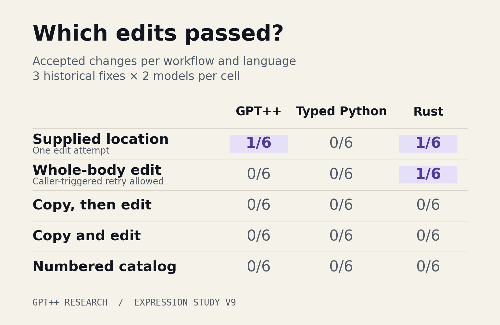
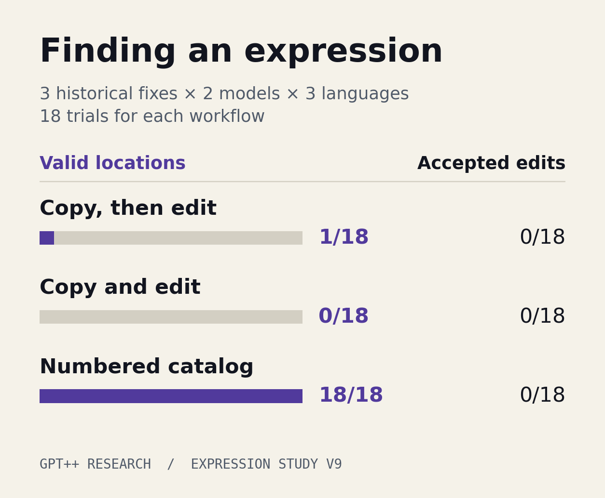
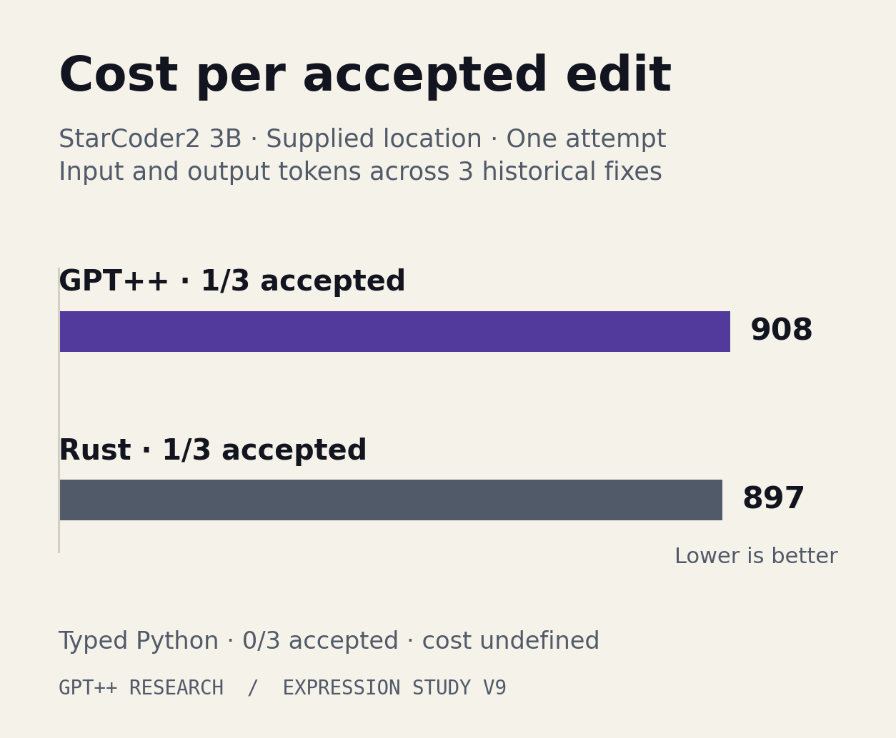

# Expression edits on historical maintenance tasks

The compiler can replace a single expression while keeping its callers and surrounding code intact. In this study, both models struggled to decide **which expression to change and what value it should compute**. Giving a model the correct site produced one GPT++ repair. Charging the model for finding the site produced zero accepted GPT++ repairs.

The main experiment used three historical changes from Redis, FastLED and Go, two caller paths per change, three languages and two local models. Each language received the same public examples, edit scope and retry rule. The target function was supplied. There were **72 assigned trials and 92 model calls**. A follow-up generated **18 more calls** on those same tasks. [Frozen protocol](protocol.md) · [Upstream revisions, test domains and callers](sources.md)

## Example-filtered repair

A later development study used the same fixtures to test the new repair CLI. Both models selected a Redis fix that passed the withheld checks. Both abstained on FastLED and received an empty menu for Go. Taking the first candidate with no model also solved Redis, but would have published a wrong FastLED fix. After the choices were frozen, scoring every candidate showed that the search had found one correct FastLED fix among the six options. [Results](results/repair.md) · [Full menu audit](results/repair-menu.md) · [Protocol](repair-protocol.md) · [Raw product trials](results/repair.jsonl)

### Selecting a patch with additional behavior examples

A separate follow-up gave the tool a pool of unlabeled inputs and access to an independent specification oracle. On FastLED, two answers to questions selected by the tool isolated a patch that passed every withheld check. The Redis candidates agreed on the entire probe pool, and taking the first candidate passed the tests. Go still had no candidate. This assisted workflow accepted two of the three tasks with two additional oracle labels and zero model calls. [Question and answer log](results/distinguish.md) · [Frozen pools and answer rules](distinguish-protocol.md) · [Raw partition and timing records](results/distinguish.jsonl)

## Charts and data







The CSV has one row per workflow, model and language. It gives model calls, input and output tokens, and accepted edits both through the first edit and through the full budget. A blank tokens-per-accept value means no change passed the checks. [Download CSV](community/benchmark-summary.csv)

## What passed

| Workflow | GPT++ | Typed Python | Rust |
|---|---:|---:|---:|
| Model copies the old expression, then fills it | 0/6 | 0/6 | 0/6 |
| Model gives the old and new expression together | 0/6 | 0/6 | 0/6 |
| Editor supplies the site, one attempt | 1/6 | 0/6 | 1/6 |
| Whole-body edit with a caller-triggered retry | 0/6 | 0/6 | 1/6 |
| Follow-up with numbered expressions, one call | 0/6 | 0/6 | 0/6 |

Each cell covers three tasks on each of two models. The successful known-site edits both repaired Redis on StarCoder2. The successful whole-body edit repaired Go on Qwen's retry. Public caller failures triggered 19 retries across the original study and recovered this one change. The first prompts contained the target function and public assertions. Caller implementation excerpts appeared only on eligible retries. [Per-model results and uncertainty](results/expression.md) · [Prompts and completions](results/expression.jsonl)

### Token cost and acceptance

The prespecified Qwen comparison counted the cost of selecting and editing a site. GPT++, typed Python and Rust each finished with **0/3** accepted changes. A cost per accepted edit and its percentage saving are therefore undefined.

The direct numerical comparison was the secondary, **known-site StarCoder2** condition. GPT++ used **908** tokens per accepted change, Rust **897**, and typed Python had zero accepts. Both successful edits fixed the same Redis call paths. Across the three tasks, GPT++ spent **11 more tokens** than Rust for the same number of accepted fixes. Typed Python has no cost per accepted edit in this condition. The paired interval for the cost ratio spans zero to infinity because many resamples have zero successes. This is a development result on three scalar extracts. [Paired comparisons](results/expression.md)

## What changed after the first run

Free-text selection produced one valid expression across 18 standalone locator calls. None of the 18 combined old/new diff responses satisfied the required format and uniquely selected a site. In the known-site GPT++ arm, all three Qwen first responses continued beyond the expression into a semicolon. The model often attempted to complete the surrounding program.

We added an experimental one-call editor that lists the actual syntax nodes, assigns a distinct ID to each occurrence, and constrains the reply to an ID and a replacement string. GPT++, typed Python and Rust each received the same interface. This follow-up ran on the original tasks after the failures were inspected. It measures the combined effect of the catalog, JSON decoding and ordinary prompt transport. [CLI usage](../../tools/README.md#pick-a-numbered-expression) · [Follow-up protocol](catalog-protocol.md)

All **18/18** responses identified a listed site. **0/18** passed both public and withheld tests. For example, Qwen's Python Redis change passed all public cases but mapped a valid maximum timestamp to zero. Its GPT++ Go change tried to multiply a Boolean by an integer. StarCoder2's three GPT++ replacements all introduced recursive call paths that exhausted the interpreter's budget. The full catalog also cost tokens. On Qwen, the three GPT++ follow-up calls used 1,507 tokens in total, compared with 884 for the original three standalone selections that failed before the edit call. [Catalog results](results/catalog.md) · [All structured responses](results/catalog.jsonl)

## Verification

- The 9 public and 43 withheld examples exercise both changed and preserved behavior. All three reference languages passed all 52 cases, and all nine hand-authored expression patches passed the same checks after applying through the editing adapters. Independent execution of the pinned upstream calculations matched the fixture translations in 288,140 comparisons. [Fixture boundaries](sources.md) · [Upstream verifier](verify_upstream.py)
- The two frozen studies archive exact requests, completions, sampling settings and usage. Behavioral replay reconstructs the edits and reruns the checks. For Rust panic diagnostics it compares all text except the process-specific thread number, then restores the recorded number when reconstructing a retry prompt. Both patch hashes and recorded model prompts must still match. [Replay program](replay.py)
- A separate product replay exercised all 18 original GPT++ expression trials through the real proposal CLI. All 19 generated requests matched the archive byte-for-byte, including the caller retry. The successful patch matched its hash and passed withheld cases. A further live StarCoder2 run produced the same Redis fix, passed the public cases and built a native program whose caller returned the expected 16,776,225. [CLI parity checker](replay_product.py)

## Reproduce

Run the following commands from the repository root. Regenerating reports only requires Python 3.10 or newer.

```sh
python3 -B bench/expression/report_expression.py bench/expression/results/expression.jsonl
python3 -B bench/expression/catalog_study.py --report bench/expression/results/catalog.jsonl
```

To regenerate the PNGs and CSV, install Matplotlib 3.9.0 and run `python3 -B bench/expression/community.py`. Pass `--output` to write to a different directory.

For behavioral replay of the original expression and catalog studies, use a separate checkout of commit `3656727` with the archived compiler sources. Use the pinned macOS, Rust and Python setup from the earlier maintenance studies. The standalone Rust syntax helper uses a locked Cargo dependency tree. On a machine with an empty Cargo cache, fetch it once. Archived replay checks executable and source hashes. Rust debug builds can vary with checkout path, toolchain and platform. The saved reports can be regenerated independently of those binaries. [Baseline environment](../empirical/README.md#reproduce)

```sh
cargo build --locked --offline
cargo fetch --locked --manifest-path bench/expression/rust_syntax/Cargo.toml
cargo build --locked --offline --manifest-path bench/expression/rust_syntax/Cargo.toml --target-dir target/expr-rust-syntax
target/empirical-venv/bin/python -B bench/expression/replay.py
target/empirical-venv/bin/python -B bench/expression/replay_product.py bench/expression/results/expression.jsonl
```

To reproduce the native upstream comparison, run `python3 -B bench/expression/verify_upstream.py` with a C compiler and Go installed. It fetches nine source files by pinned revision and checks each content hash. Add `--offline` to use the verified cache.

For new generations, use local Ollama with the two archived model digests. The follow-up uses the checked-in original archive as its comparator. Keep new runs at fresh paths.

```sh
target/empirical-venv/bin/python -B bench/expression/run_expression.py target/expression-new.jsonl
target/empirical-venv/bin/python -B bench/expression/catalog_study.py target/catalog-new.jsonl
```

To replay the original example-filtered repair and distinguishing-input studies, use a separate checkout of commit `245cb7e` and build its compiler. Run the following commands in that checkout. The runner invokes the ordinary GPT++ CLI and independently checks the recorded selections with the macOS benchmark evaluator. Offline replay uses the saved local-model replies. A fresh run of that archived workflow requires Ollama with the two recorded model digests and a new output path.

```sh
cargo build --locked --offline
python3 -B bench/expression/repair_study.py --report bench/expression/results/repair.jsonl
target/empirical-venv/bin/python -B bench/expression/repair_study.py --replay bench/expression/results/repair.jsonl
target/empirical-venv/bin/python -B bench/expression/audit_repair_menu.py bench/expression/results/repair.jsonl
target/empirical-venv/bin/python -B bench/expression/repair_study.py target/repair-new.jsonl
target/empirical-venv/bin/python -B bench/expression/distinguish_study.py --replay bench/expression/results/distinguish.jsonl
```

The repair archive’s `capture_provenance` field preserves the original capture manifest, its complete archive hash and the hash of the six trial rows. A subsequent metadata correction enumerated the specific dependencies and removed the unrelated old catalog frontend from the source check. The captured runner and its revised manifest-checking version have distinct fingerprints. The recorded product code, model requests, responses, trial rows and scores were retained. To reconstruct the original bytes, serialize `capture_provenance.original_manifest` with Python’s default `json.dumps`, append a newline, then append the six original JSONL lines verbatim.

## Agent-generated expressions with public feedback

The free-generation editor proposes one new native expression and can retry once after a public diagnostic. The matched GPT++, typed Python and Rust study includes the earlier project extracts and a separate block of three new scalar contracts. Each language uses the same structured response, change specification, public examples and retry limit. The GPT++ trials invoke the actual product CLI. [Historical task results](results/agent.md) · [New-task results](results/fresh-agent.md) · [Historical protocol](agent-protocol.md) · [New-task protocol](agent-fresh-protocol.md)

Recreate both reports with Python. Behavioral replay uses the macOS benchmark environment and the checked edit adapters. Fresh inference uses the pinned local models and requires a new archive path. For reproducible replay, use the runner and authoring tools from Git revision `d5ccb17` with the pre-extension compiler from revision `245cb7e`. The older runner fingerprints its authoring sources. The current contract-mode CLI has a different fingerprint. Run the following replay commands in the `d5ccb17` checkout.

```sh
python3 -B bench/expression/agent_study.py --report bench/expression/results/agent.jsonl
python3 -B bench/expression/fresh_agent_study.py --report bench/expression/results/fresh-agent.jsonl
git worktree add --detach target/agent-compiler-before 245cb7e
cargo build --manifest-path target/agent-compiler-before/Cargo.toml --locked --offline
target/empirical-venv/bin/python -B bench/expression/replay_agent.py --gpp target/agent-compiler-before/target/debug/gpp bench/expression/results/agent.jsonl
target/empirical-venv/bin/python -B bench/expression/replay_agent.py --gpp target/agent-compiler-before/target/debug/gpp bench/expression/results/fresh-agent.jsonl
```

During the historical block, the live compiler build path changed as the batch probe command was added. The archive records the two observed binary fingerprints, the initial capture hash and the hash of every original trial row. Individual historical calls did not record a binary hash. The new-task runner takes a private compiler copy before starting its assignments. Timing in both blocks describes the recorded development machine and sandboxed adapters.

### Rechecking frozen GPT++ answers after extending the language

The explicit `as I64` conversion and native integer `min`, `max` and `clamp` calls were motivated by expressions generated in the arithmetic block. A separate retrospective applied all 24 archived GPT++ answers from both blocks to their original source bytes. No new model responses were generated. On the three new contracts, Qwen’s original answer sequence went from zero to three accepted changes. Its signed-saturation expression passed on the first answer. Half-open windows and timeout quantization passed with the originally saved retry. The three selected patches also passed 879 additional direct checks. Neither model repaired a historical fixture in this replay, and StarCoder2 repaired none of the new tasks. [Retrospective results](results/compat.md) · [Scoring protocol](compat-protocol.md) · [Patch and response hashes](results/compat.jsonl)

Run this compiler-compatibility replay from the `d5ccb17` checkout using the compiler built in that same checkout. The archive checks the compiler source fingerprints.

```sh
cargo build --locked --offline
python3 -B bench/expression/compat_study.py --report bench/expression/results/compat.jsonl
target/empirical-venv/bin/python -B bench/expression/compat_study.py --replay bench/expression/results/compat.jsonl
```

## Measure compiler session latency

The current compiler batches the same candidate edits and supplied calls. The comparison requires identical JSON outputs on all nine workloads over three alternating repetitions. Build revision `245cb7e` in `target/probe-baseline` or pass an existing checkout using `--baseline PATH`.

```sh
mkdir -p target/probe-baseline
git archive 245cb7e | tar -x -C target/probe-baseline
cargo build --locked --offline --manifest-path target/probe-baseline/Cargo.toml
cargo build --locked --offline
target/empirical-venv/bin/python -B bench/expression/probe_study.py target/probe-new.jsonl
python3 -B bench/expression/probe_study.py --report bench/expression/results/probe.jsonl
```

The [native program study](../runtime/README.md) measures execution time and peak memory across GPT++, Rust and Python.
