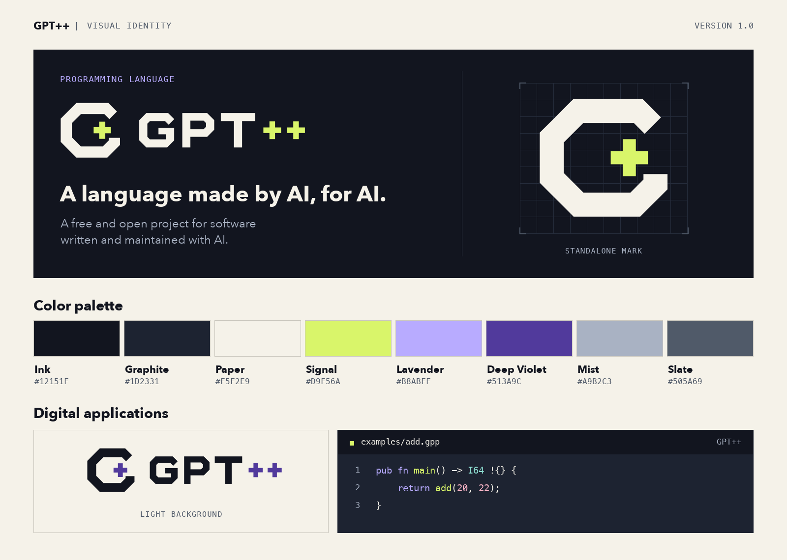

# GPT++ digital identity

**A language made by AI, for AI.**

GPT++ is a free and open project building an experimental programming language and toolchain for AI-assisted software maintenance. The `gpp` compiler checks `.gpp` source and runs offline. Use **GPT++** in titles and prose, `gpp` in commands, and `.gpp` for the file extension. Name the action a reader can take, such as checking a module, previewing a change, or running a program. [Project overview](../README.md) · [Language design](../docs/design.md)

## Logo

The mark is an open, angular **G** with a plus inside it. The opening gives the plus room to read at small sizes. The horizontal lockup pairs the mark with the **GPT++** wordmark.

- Use the dark-surface lockup on Ink or Graphite and the light-surface lockup on Paper or White. Use the standalone two-color mark on dark surfaces where the name is already visible. Use the monochrome mark for one-color output on light surfaces and the square avatar for project profiles.
- Leave at least the width of the plus inside the mark as clear space on every side. Measure from the visible edges of the artwork.
- Use the standalone mark at 24 px wide or larger and the full lockup at 144 px wide or larger. Use the dedicated favicon in browser tabs.
- Keep the supplied proportions, spacing, and colors. Place the logo on a solid field and use the supplied artwork for the wordmark.
- Give a standalone logo the text alternative `GPT++`. Use an empty alternative when adjacent text already provides the name. Label a logo-only link according to its destination, such as `GPT++ home`.

## Color

| Color | sRGB hex | Role |
| --- | --- | --- |
| Ink | `#12151F` | Dark canvas, primary light-theme text |
| Graphite | `#1D2331` | Raised dark surface and code panels |
| Paper | `#F5F2E9` | Light canvas, primary dark-theme text |
| Signal | `#D9F56A` | Dark-theme primary actions and logo accent |
| Lavender | `#B8ABFF` | Dark-theme links, focus, and highlighted code |
| Deep Violet | `#513A9C` | Light-theme links, actions, focus, and logo accent |
| Mist | `#A9B2C3` | Secondary dark-theme text and code comments |
| Slate | `#505A69` | Secondary light-theme text and code comments |

| Foreground | Background | Contrast |
| --- | --- | ---: |
| Paper | Ink / Graphite | 16.27:1 / 14.03:1 |
| Mist | Ink / Graphite | 8.54:1 / 7.36:1 |
| Signal | Ink / Graphite | 14.94:1 / 12.88:1 |
| Lavender | Ink / Graphite | 8.94:1 / 7.71:1 |
| Ink | Paper / White | 16.27:1 / 18.22:1 |
| Slate | Paper / White | 6.24:1 / 6.98:1 |
| Deep Violet | Paper / White | 7.70:1 / 8.62:1 |
| Ink | Signal button fill | 14.94:1 |
| Paper | Deep Violet button fill | 7.70:1 |

The light theme uses White (`#FFFFFF`) for raised surfaces. These opaque sRGB pairs meet the WCAG 2.2 AA threshold of 4.5:1 for normal text. Underline links in body copy and give status colors a text label or an icon with an accessible name. Recheck contrast over gradients, images, and transparent surfaces. [W3C contrast criterion](https://www.w3.org/WAI/WCAG22/Understanding/contrast-minimum.html) · [sRGB luminance formula](https://www.w3.org/TR/WCAG22/#dfn-relative-luminance)

## Type and layout

- **Headlines and interface text.** Use Inter with a system sans-serif fallback. Use bold weight for headlines and regular weight for explanatory copy. A 16 px base size and 1.5 line height are good starting points for documentation.
- **Code, commands, and file paths.** Use IBM Plex Mono with Menlo and monospace fallbacks. Present code as selectable text in documentation. The source example `gpp check examples/add.gpp` is a useful visual specimen.
- **Layout.** Use flat color fields, left-aligned text, and generous space around code and the mark. Use the Signal accent on dark compositions and Deep Violet on light compositions to draw attention to the primary action.

## Files

| Asset | Files |
| --- | --- |
| Visual identity board | [PNG](identity.png) · [GIMP source](source/gptpp-identity.xcf) |
| Logo family | [GIMP source](source/gptpp-logo.xcf) |
| Lockup on dark | [SVG](logo/gptpp-dark.svg) · [PNG](logo/gptpp-dark.png) |
| Lockup on light | [SVG](logo/gptpp-light.svg) · [PNG](logo/gptpp-light.png) |
| Standalone mark | [SVG](logo/gptpp-mark.svg) · [PNG](logo/gptpp-mark.png) |
| Single-color Ink mark | [SVG](logo/gptpp-mark-mono.svg) · [PNG](logo/gptpp-mark-mono.png) |
| Square avatar | [SVG](logo/gptpp-avatar.svg) · [PNG](logo/gptpp-avatar.png) |
| Browser favicon | [ICO](logo/favicon.ico) |
| Social sharing card (1200 × 630 px) | [PNG](social-card.png) · [GIMP source](source/gptpp-social.xcf) |
| GIMP color palette | [GPL](gptpp.gpl) |
| Web theme | [CSS custom properties](theme.css) |

Open the layered XCF files in GIMP to edit the artwork. In the logo master, toggle the light and dark lockup groups and their preview backgrounds in the Layers panel. The identity board and social card use editable Avenir Next and Menlo text layers. In GIMP's Palettes dialog, use **Import Palette** to load `gptpp.gpl`. Use SVG for scalable logos and PNG for platforms that require raster uploads. Export digital artwork in sRGB and keep transparency on logo exports.

Load `theme.css` in a web project and apply the semantic `--gpp-*` variables to surfaces, text, links, and controls. The stylesheet follows the system color scheme by default. Set `data-theme="light"` or `data-theme="dark"` on the document root to choose a mode explicitly.

Use `--gpp-bg` for the page, `--gpp-surface` for raised panels, and `--gpp-text` and `--gpp-muted` for copy. Pair `--gpp-primary` with `--gpp-on-primary` for buttons. Offset the `--gpp-focus` outline so it sits against the surrounding surface.

For syntax highlighting, use `--gpp-syntax-*` against the page or raised surface. Keywords use the link color, function names use Ink in light mode and Signal in dark mode, comments use muted text, and operators use regular text. The additional syntax colors below also meet the normal-text AA threshold on their respective theme backgrounds.

| Syntax | Light on Paper / White | Dark on Ink / Graphite |
| --- | --- | --- |
| Types and strings | `#126350` · 6.41:1 / 7.18:1 | `#8DDED1` · 11.71:1 / 10.10:1 |
| Numbers | `#9A3A55` · 6.03:1 / 6.75:1 | `#FFB8CB` · 11.25:1 / 9.70:1 |
